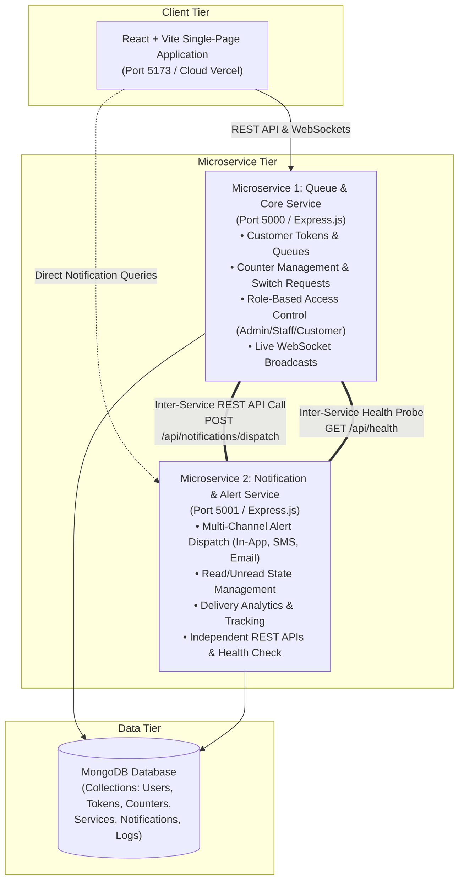
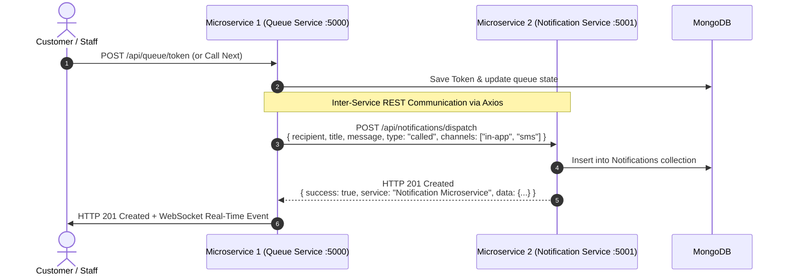

# QueueLess - Dual Microservices Architecture & System Design Document

**Course:** Full Stack Web Development (CAT-2)  
**System:** QueueLess – Intelligent Virtual Queue Management System  
**Architecture Pattern:** Distributed Microservices Architecture with Inter-Service REST API Communication  

---

## 1. System Overview

QueueLess is decomposed into **two independent backend microservices** and a **responsive modern single-page frontend application**, connected to **MongoDB**:



---

## 2. Microservice Specifications

### Microservice 1: Queue & Core Management Service
- **Runtime & Port:** Node.js / Express on `http://localhost:5000`
- **Core Responsibilities:**
  - Authentication & JWT issuance (Admin, Staff, Customer).
  - Service queue lifecycle (Token generation, priority queues, algorithmic wait-time estimation).
  - Staff counter operations (Call Next, Start Service, Complete Service, Recall, Transfer).
  - Counter switch requests with Admin approval workflow.
  - Real-time Socket.IO broadcasts for live waiting boards.
- **REST APIs Exposed:**
  - `POST /api/auth/login`, `POST /api/auth/register`
  - `GET /api/queue/services`, `POST /api/queue/token`, `GET /api/queue/my-token`
  - `POST /api/staff/call-next`, `PUT /api/staff/complete-service`, `POST /api/staff/switch-counter`
  - `PUT /api/admin/counter-switch-requests/:id/approve`
  - `GET /api/health`

### Microservice 2: Notification & Alert Service
- **Runtime & Port:** Node.js / Express on `http://localhost:5001`
- **Core Responsibilities:**
  - Cross-channel notification dispatch (In-App, simulated SMS, email).
  - Persisting notification state, read receipts, and timestamps.
  - Calculation of delivery metrics and channel distribution analytics.
  - Independent health monitoring and cross-service reachability probes.
- **REST APIs Exposed:**
  - `POST /api/notifications/dispatch` *(Inter-service REST endpoint called by Queue Service)*
  - `GET /api/notifications` *(User notifications with unread count)*
  - `PUT /api/notifications/:id/read` *(Mark single item as read)*
  - `PUT /api/notifications/read-all` *(Mark all as read)*
  - `DELETE /api/notifications/:id` *(CRUD Delete)*
  - `GET /api/notifications/analytics` *(Delivery statistics & breakdown)*
  - `GET /api/notifications/health` *(Inter-service connectivity check)*
  - `GET /api/notifications/info` *(Microservice capability metadata)*

---

## 3. Inter-Service REST API Communication Flow

Whenever an event occurs in **Microservice 1** (e.g., customer creates a token, staff calls token to counter, staff requests counter switch, admin approves request), **Microservice 1 initiates an HTTP REST call to Microservice 2**:



### High Availability & Fault Tolerance
If Microservice 2 is temporarily restarting or unreachable, `notificationClient.js` in Microservice 1 catches the network timeout gracefully, falls back to local logging, and ensures customer ticket operations never fail.

---

## 4. Database CRUD Operations Matrix

Both microservices execute structured CRUD operations on MongoDB:

| Entity | Create (C) | Read (R) | Update (U) | Delete (D) | Service |
| :--- | :--- | :--- | :--- | :--- | :--- |
| **Users / Staff** | Registration / Add Staff | User Profile, Staff List | Profile Update, Counter Switch | Deactivate User | Microservice 1 |
| **Tokens / Queues** | Issue Token (`/api/queue/token`) | Active Queue, My Token | Call, Serve, Complete, Transfer | Cancel Token | Microservice 1 |
| **Counters** | Create Counter Desk | Get All Counters | Assign Staff, Update Status | Remove Counter | Microservice 1 |
| **Notifications** | `POST /api/notifications/dispatch` | `GET /api/notifications` | `PUT /:id/read`, `PUT /read-all` | `DELETE /:id` | Microservice 2 |
| **Logs & Analytics** | QueueLog record on event | Analytics summary & charts | Aggregate statistics | Archive Old Logs | Both Services |

---

## 5. How to Run Locally

### Prerequisites
- Node.js v18+ (tested on Node v24)
- MongoDB instance running locally on `mongodb://127.0.0.1:27017` (or MongoDB Atlas)

### 1. Install Dependencies
```powershell
npm run install:all
```

### 2. Start Both Microservices & Frontend Concurrently
```powershell
npm run dev
```
This single command runs:
- **`[QUEUE-SRV]`** on `http://localhost:5000`
- **`[NOTIF-SRV]`** on `http://localhost:5001`
- **`[CLIENT]`** on `http://localhost:5173`

---

## 6. Testing with Postman (Criterion 5)

A complete Postman Collection is provided in the repository:
📁 `postman/QueueLess_Microservices_API.postman_collection.json`

### Steps to Test:
1. Open Postman ➔ Click **Import** ➔ Select the JSON file.
2. Run **Health Check** for both services:
   - `GET http://localhost:5000/api/health`
   - `GET http://localhost:5001/api/notifications/health`
3. Execute **Inter-Service REST Dispatch**:
   - `POST http://localhost:5001/api/notifications/dispatch` with payload:
     ```json
     {
       "recipient": "<user_id>",
       "title": "Your Token is Called",
       "message": "Proceed to Counter 1",
       "type": "called",
       "channels": ["in-app", "sms"]
     }
     ```
4. Verify response contains `service: "Notification Microservice"`.

---

## 7. Cloud Deployment Guide (Criterion 4)

Both services and frontend can be deployed on free cloud tiers:

### Microservice 1 & Microservice 2 Deployment (Render.com)
1. Push repository to GitHub.
2. In **Render.com** ➔ New **Web Service**:
   - **Service 1 (Queue):**
     - Root Directory: `server`
     - Build Command: `npm install`
     - Start Command: `node src/server.js`
     - Env vars: `MONGODB_URI` (from MongoDB Atlas), `NOTIFICATION_SERVICE_URL` (URL of Service 2)
   - **Service 2 (Notification):**
     - Root Directory: `notification-service`
     - Build Command: `npm install`
     - Start Command: `node src/server.js`
     - Env vars: `MONGODB_URI`, `QUEUE_SERVICE_URL` (URL of Service 1)

### Frontend Deployment (Vercel)
1. In **Vercel** ➔ Import Git Repository.
2. Root Directory: `client`
3. Build Command: `npm run build`
4. Output Directory: `dist`
5. Environment Variable: `VITE_API_URL=<Render_Queue_Service_URL>`

---

## 8. Viva Voce Preparation (10 Marks)

| Question | Recommended Answer |
| :--- | :--- |
| **Q1: Why did you split the system into two microservices?** | "To separate the high-throughput queue and counter operational logic (Service 1) from cross-channel notification dispatch and delivery analytics (Service 2). This allows scaling notification handling independently without slowing down real-time token processing." |
| **Q2: How do your microservices communicate?** | "They communicate synchronously via REST APIs using Axios HTTP POST/GET requests. Specifically, when a token is issued or called in Service 1, it makes an HTTP POST request to Service 2's `/api/notifications/dispatch` endpoint with resilient fallback error handling." |
| **Q3: What happens if Service 2 goes down?** | "Service 1 implements graceful error handling in `notificationClient.js`. If Service 2 is unreachable, Service 1 catches the error, logs a warning, and saves the record to a fallback store so queue operations never fail for the user." |
| **Q4: How does authentication work across services?** | "Both services share a stateless JWT architecture. The client logs in through Service 1 to obtain a signed JWT. When making requests to Service 2, the Bearer token is verified statelessly by Service 2's auth middleware." |
